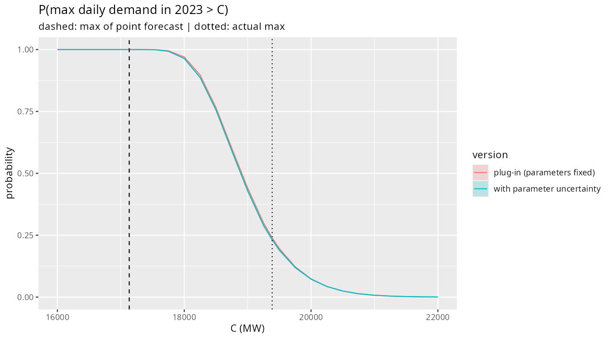
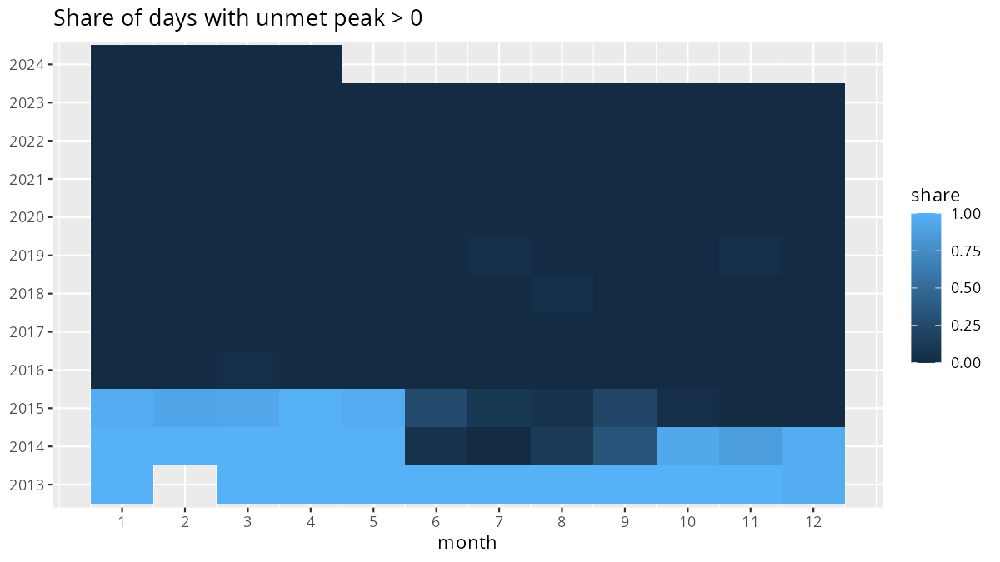
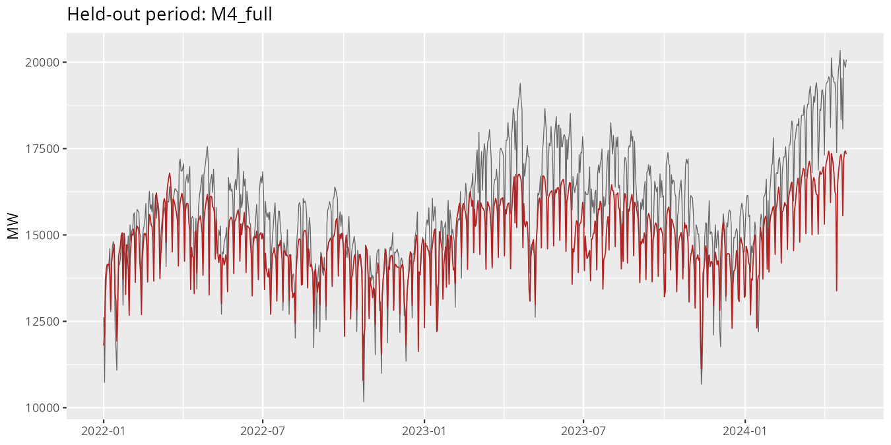
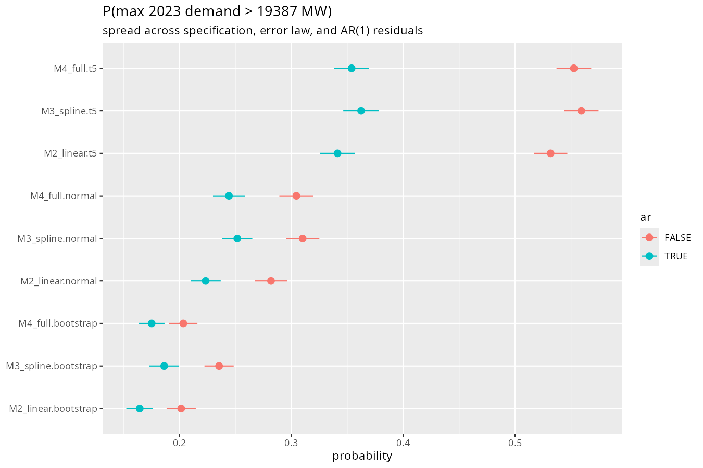
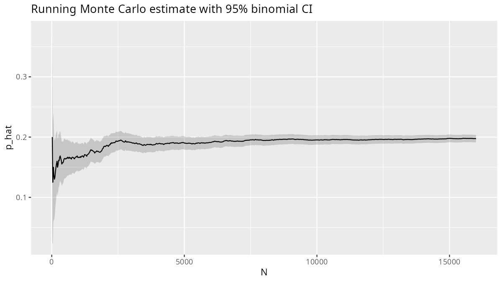
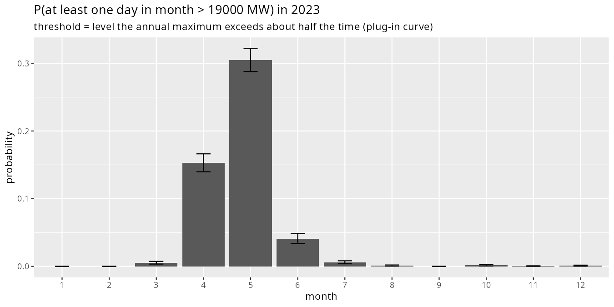
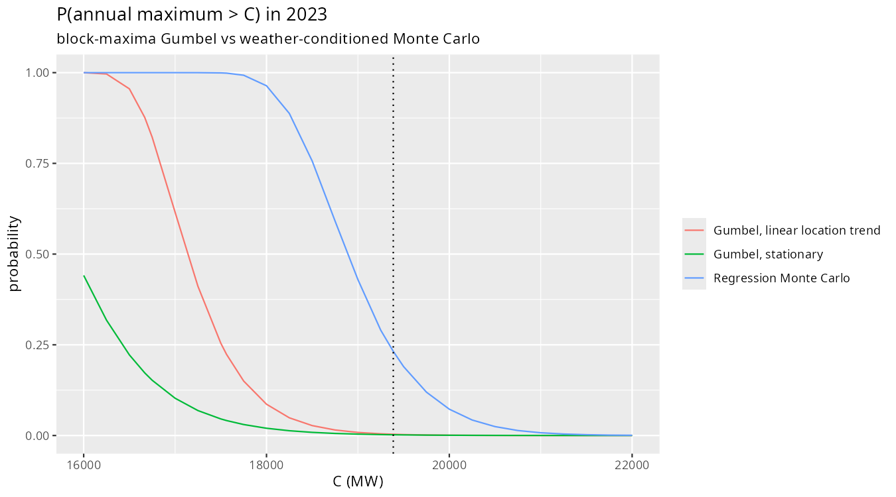
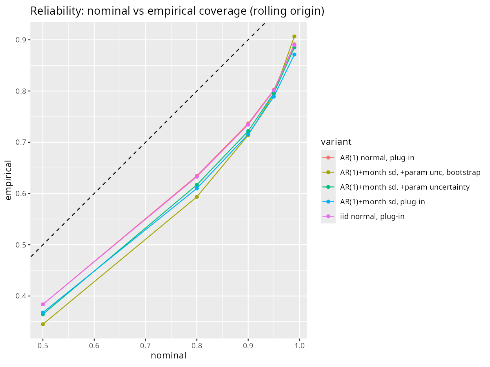

# Quantifying Uncertainty in Electricity Demand: A Monte Carlo Study of Tamil Nadu's Power System

A case study conducted in **R**. Instead of producing a single demand forecast, it estimates the *distribution* of plausible peak demand and the probability that demand exceeds a given capacity, then tests whether those probabilities can be trusted.

> **Research question.** How reliably can we estimate high-demand days from historical electricity and weather data, and how does accounting for uncertainty change our assessment of peak-demand risk?

The quantity of interest is

$$
p(C) = P\left(\max_t D_t > C\right) \approx \frac{1}{N}\sum_{i=1}^{N} \mathbf{1}\left[\max_t D_t^{(i)} > C\right],
$$

where $D_t$ is daily peak demand, $C$ is a capacity threshold, and $D_t^{(i)}$ is the $i$-th of $N$ simulated demand paths.



**Quick links:** [Key findings](#key-findings) · [Methodology](#methodology) · [Results](#results) · [Build and run](#build-and-run)

---

## Key findings

| Question | Answer |
|---|---|
| How well does the regression fit? | Adjusted R² = 0.717; 6.0% mean absolute percentage error on held-out data (2022 to April 2024). |
| What does a single forecast miss? | The maximum of the point forecast lies below the 5th percentile of the simulated 2023 annual maximum. Simulated median: 18.9 GW; 90% range: about 18.0 to 20.2 GW. |
| How likely was 2023's actual peak? | The model gives P(max > 19,387 MW) = **0.23**. A Gumbel fit to seven annual maxima gives about 0.002. |
| How much does weather matter? | The same probability rises to **0.63** with +2 °C and **0.81** with +3 °C. |
| How big is each source of uncertainty? | Monte Carlo sampling error ≈ 0.002; spread of risk across plausible parameters ≈ 0.10; spread across modelling choices: 0.17 to 0.56. |
| Are the intervals calibrated? | Nominal 95% intervals contain **80%** of days pooled, **89%** excluding the COVID-affected years 2020–21. In 2023 all excess misses are on the high side. |
| Forward look | About **0.73** probability of beating the 20,583 MW record in the 365 days after April 2024 (0.99 with +2 °C). Risk is concentrated in April and May. |

The calibration result is the most interesting finding: the pooled shortfall is driven mostly by the 2020 lockdown, which no model trained on earlier data could foresee, plus a one-sided failure in 2023 when demand growth outpaced a linear trend.

---

## Repository structure

```
.
├── R/
│   ├── specs.R                    # Shared config, calendar features, model specs
│   ├── mc_functions.R             # Monte Carlo engine (bootstrap, AR(1) paths, scenarios)
│   ├── run_all.R                  # Runs the whole pipeline
│   ├── 00_download_inspect.R      # Downloads the Zenodo files
│   ├── 01_prepare_data.R          # Cleaning and merging
│   ├── 02_eda.R                   # Phase 1: exploratory analysis
│   ├── 03_unmet_demand.R          # Phase 1: supplied vs unmet demand
│   ├── 04_model.R                 # Phase 2: regression models and diagnostics
│   ├── 05_monte_carlo.R           # Phase 3: exceedance risk, scenarios, model uncertainty
│   ├── 05b_block_maxima.R         # Phase 3: Gumbel annual-maxima comparison
│   ├── 06_calibration.R           # Phase 4: rolling-origin interval coverage
│   └── 06b_calibration_by_year.R  # Phase 4: where the coverage failures come from
├── outputs/                       # Result tables (CSV/RDS)
├── figures/                       # Figures referenced below
├── REPORT.md                      # Full written report
└── README.md
```

---

## Data

- **Demand and weather:** [Zenodo record 14983362](https://zenodo.org/records/14983362): daily energy supplied (MU), peak power supplied (MW) and peak unmet demand (MW) for Indian states, plus daily weather for each state (temperature, dewpoint, wind, solar radiation, cloud cover, UTCI). Licence: CC BY 4.0.
- **Not used:** a national hourly dataset with solar and wind generation (not state-level), and a 2013 Thanjavur-area feeder dataset (wrong spatial scale and structure).

The raw files are **not** stored in this repository. `R/00_download_inspect.R` downloads them into `data/raw/`.

### Cleaning decisions

- **Duplicate dates.** Each demand file lists 55 dates twice. Where the two rows agree they are merged; where they conflict (7 dates for energy and peak supplied, 3 for unmet) the value is set to missing, since there is no way to tell which is correct.
- **Missing days.** 236 calendar days are absent. Lags and rolling means of temperature are computed on the complete weather series before merging, so "yesterday" always means yesterday.
- **Units.** Temperatures arrive in Kelvin and are converted to Celsius.
- **Demand definition.** Underlying peak demand is `peak supplied + peak unmet`.
- **Modelling window starts in 2016.** Unmet demand occurred on 99.6% of days in 2013, 68% in 2014 and 46% in 2015, then almost never. Before 2016, supplied power understates demand, so those years are used for exploration only.
- **Dropped record day.** The highest day in the file (20,583 MW, 26 April 2024) is excluded from the model data because solar radiation is missing that day. It is used as the record threshold in the forward look.



---

## Methodology

### 1. Exploratory analysis

Seasonality, trend, extremes, weather association and autocorrelation (`02_eda.R`). Demand rises about 386 MW per year in the annual maximum (95% CI 155 to 617 MW), peaks in spring, and has a clear weekday and holiday pattern.

### 2. Regression model

Log demand is regressed on calendar, weather and trend terms (`04_model.R`):

$$
\log D_t = \beta_0 + \beta_1 t + \text{weekday}_t + \gamma_h H_t + \gamma_f F_t + \gamma_c C_t + \gamma_\ell L_t + \sum_{k=1}^{3}\left[a_k \sin\tfrac{2\pi k d_t}{365.25} + b_k\cos\tfrac{2\pi k d_t}{365.25}\right] + f(T^{\max}_t) + \delta \overline{T}^{(3)}_t + \theta_1 \text{Dew}_t + \theta_2 \text{Solar}_t + \theta_3 \text{Cloud}_t + \varepsilon_t
$$

where $H$ marks public holidays, $F$ the Diwali window, $C$ the COVID period, $L$ the hard 2020 lockdown, $f$ is a natural cubic spline with 4 degrees of freedom, and $\overline{T}^{(3)}$ is the 3-day mean of maximum temperature. Five specifications are compared (calendar only, linear temperature, spline, full model, and a GAM). Standard errors use Newey-West (HAC) corrections.

The residuals are **autocorrelated** (lag-1 correlation about 0.67), have **unequal variance across months** (log-scale SD from 0.033 in February to 0.070 in May) and are **heavy-tailed** (kurtosis 5.75). These three facts determine how the simulation is built.

### 3. Monte Carlo simulation

Implemented in `R/mc_functions.R`. For each of $B$ parameter draws:

1. **Parameter uncertainty:** resample standardised residuals in 14-day blocks (preserving autocorrelation), rebuild the response and refit the regression.
2. **Weather:** use observed weather, a shifted version (+1 to +3 °C), or the weather of a randomly chosen historical year (1979 to 2023).
3. **Errors:** simulate $M$ paths with AR(1) errors scaled by month-specific standard deviations (normal, $t_5$, or bootstrapped innovations).
4. **Statistic:** record the share of paths whose maximum exceeds each threshold $C$.

With $B = 1000$ and $M = 50$, each scenario uses 50,000 simulated years. Splitting the simulation into $B \times M$ lets the code separate pure Monte Carlo error from parameter uncertainty:

- `mc_se_binom`: binomial Monte Carlo error, $\sqrt{\hat p(1-\hat p)/N}$
- `param_sd`: spread of the conditional probability across parameter draws, after removing within-draw binomial noise

### 4. Validation

- **Rolling origin:** for each year 2019 to 2023, fit on earlier data and simulate that year given its observed weather.
- **Coverage:** do nominal 50/80/90/95/99% intervals contain that share of observed days?
- **Formal tests:** Kupiec (coverage) and Christoffersen (independence of misses), plus PIT histograms.
- **Annual-maxima comparison:** a Gumbel distribution fitted to annual maxima, with and without a trend.

---

## Results

### Model fit and held-out accuracy

| Model | Weather terms | Adj. R² | Test MAPE |
|---|---|---|---|
| M1 | none | 0.586 | 7.16% |
| M2 | max temperature | 0.692 | 6.36% |
| M3 | temperature spline + dewpoint | 0.700 | 6.24% |
| **M4 (chosen)** | + 3-day temperature, solar, cloud | **0.717** | **6.01%** |
| M5 | GAM | 0.705 | 6.17% |

Estimated effects (percent change in demand): trend +2.0% per year, Sundays −9.2%, public holidays −9.5%, Diwali window −16.3%, 2020 lockdown about −23%.

Held-out error is mostly one-sided under-prediction that grows with time: a linear trend fitted on 2016 to 2021 cannot capture the later acceleration in demand.



### Exceedance risk for 2023 (trained on 2016 to 2022)

| Threshold C (MW) | P(annual max > C) |
|---|---|
| 17,563 (2022 record) | 0.999 |
| 18,500 | 0.76 |
| 19,000 | 0.43 |
| 19,387 (2023 actual) | 0.23 |
| 20,000 | 0.073 |
| 21,000 | 0.008 |

A single-number forecast hides this spread. The deterministic forecast's maximum sits below the 5th percentile of the simulated annual maximum, because the maximum of a noisy path is systematically higher than the maximum of its average path.

### Weather scenarios

| Scenario | P(max > 19,000 MW) | P(max > 19,387 MW) |
|---|---|---|
| Observed 2023 weather | 0.43 | 0.23 |
| +1 °C | 0.66 | 0.42 |
| +2 °C | 0.86 | 0.63 |
| +3 °C | 0.95 | 0.81 |
| Historical-year weather (1979 to 2023) | 0.65 | 0.43 |
| Historical-year weather +2 °C | 0.94 | 0.81 |

As far as peak risk goes, observed 2023 weather was milder than the average resampled historical year. The +1 to +3 °C scenarios are stylised stress tests, not climate projections.

### Where the uncertainty comes from



Varying the regression specification, the error distribution and the autocorrelation assumption moves P(max > 19,387 MW) between **0.17 and 0.56**, far more than Monte Carlo sampling error (about 0.002). Heavy-tailed errors push the probability up; AR(1) errors and bootstrapped innovations pull it down. Modelling choices matter more than simulation noise, and no amount of extra simulation resolves that.



### Seasonal risk

For a 2023-like year, the probability of at least one day above 19,000 MW is **0.31 in May**, **0.15 in April**, 0.04 in June, and below 0.01 in every other month.



### Forward look (next 365 days after April 2024)

Refitting on all data and resampling historical weather gives P(max > 20,583 MW, the record) of about **0.73**, rising to **0.99** with +2 °C. These depend on the linear trend continuing and are probably biased low.

### Comparison with an annual-maxima (Gumbel) model

A Gumbel distribution fitted to the seven annual maxima from 2016 to 2022 gives P(max > 19,387 MW) of about 0.002 (0.003 with a trend), versus 0.23 from the simulation. With seven data points and no weather information, the Gumbel model cannot see either the hot weather or the demand growth of 2023.



### Are the probabilities reliable?

Pooled over 2019 to 2023, a nominal 95% interval contains only about 80% of days. That figure mixes very different years:

| Year | Coverage of nominal 95% | What happened |
|---|---|---|
| 2019 | 0.90 | Close to nominal |
| 2020 | **0.51** | Demand fell below forecast on 49% of days: the COVID-19 lockdown |
| 2021 | **0.76** | Misses mostly on the high side as demand recovered |
| 2022 | 0.92 | Close to nominal |
| 2023 | 0.85 | All excess misses on the high side: growth outpaced the trend |

Excluding 2020 and 2021, coverage is about **0.89**. So the intervals are modestly too narrow in ordinary years, uncalibrated in disrupted years, and biased low in a high-growth year. Treat tail probabilities as lower bounds when demand is accelerating.



---

## Limitations

- **Linear trend.** It cannot represent the acceleration seen from 2022, so probabilities for a growth year are likely too low.
- **COVID-19** is represented by indicator variables, not a mechanism. Forecasts for 2020 cannot anticipate the lockdown.
- **One state, one period**, with a single train/test setup and small samples of years.
- **Observed-weather evaluation.** Calibration is checked given actual weather, so it ignores uncertainty in weather forecasts.
- **Festival dates** (Diwali) were entered by hand; moveable holidays other than Diwali are not modelled.
- **Stylised scenarios.** The temperature shifts are stress tests, not climate projections.

Possible extensions: a more flexible or regime-aware trend, extreme-value (GPD) tail modelling, other states, and hourly data with solar and wind generation.

---

## Build and run

There is nothing to compile: the project is a set of R scripts. "Building" means installing the packages, downloading the data, and running the pipeline.

### Requirements

- **R 4.3 or newer** (developed and tested on R 4.3.3). RStudio is optional.
- **Internet access** for the one-time data download (about 6 MB).
- **R packages:** `tidyverse`, `lubridate`, `lmtest`, `sandwich`. `MASS`, `mgcv` and `splines` are recommended packages that normally ship with R.
- **Ubuntu/Debian only:** installing the tidyverse from source may need system libraries first:
  ```bash
  sudo apt update
  sudo apt install -y build-essential libcurl4-openssl-dev libssl-dev libxml2-dev \
    libfontconfig1-dev libfreetype-dev libharfbuzz-dev libfribidi-dev \
    libpng-dev libtiff-dev libjpeg-dev
  ```
  Windows and macOS normally install prebuilt binaries and need nothing extra.

### 1. Get the code

```bash
git clone https://github.com/<your-username>/<repo-name>.git
cd <repo-name>
```

Run every command below **from this folder (the project root)**. In RStudio, open the `.Rproj` file, which sets the working directory for you.

### 2. Install the packages (once)

```r
install.packages(c("tidyverse", "lubridate", "lmtest", "sandwich"))
```

Check that everything loads:

```bash
Rscript -e 'for (p in c("tidyverse","lubridate","lmtest","sandwich","MASS","mgcv","splines")) stopifnot(requireNamespace(p, quietly = TRUE)); cat("All packages available\n")'
```

### 3. Download the data (once)

```bash
Rscript R/00_download_inspect.R
```

This saves four CSV files from Zenodo into `data/raw/` and prints their structure. Files that already exist are skipped. It is deliberately not part of `run_all.R`.

### 4. Run the pipeline

**Everything at once:**

```bash
Rscript R/run_all.R
```

or, from an R session in the project root, `source("R/run_all.R")`. The scripts run in order, print the elapsed time for each, and stop at the first error. Scripts 05 and 06 take several minutes each; the rest are quick.

**One step at a time** (each script can be run on its own, in this order):

| Script | Reads | Writes | Speed |
|---|---|---|---|
| `01_prepare_data.R` | `data/raw/*.csv` | `data/processed/tn_daily.rds`, `tn_daily.csv`, `wx_daily.rds` | fast |
| `02_eda.R` | `tn_daily.rds` | `figures/01` to `06` | fast |
| `03_unmet_demand.R` | `tn_daily.rds` | `figures/07`, console output | fast |
| `04_model.R` | `tn_daily.rds` | `outputs/model_comparison.csv`, `figures/08` to `09` | fast |
| `05_monte_carlo.R` | `tn_daily.rds`, `wx_daily.rds` | `outputs/A` to `F` tables, `figures/10` to `13` | slow |
| `05b_block_maxima.R` | `outputs/A_exceedance_curve.csv` | `outputs/G_gumbel_vs_mc.csv`, `figures/16` | fast |
| `06_calibration.R` | `tn_daily.rds` | `outputs/calibration_*.csv`, `calibration_raw.rds`, `figures/14` to `15` | slow |
| `06b_calibration_by_year.R` | `calibration_raw.rds` | `outputs/calibration_by_year.csv`, `calibration_by_subset.csv`, `figures/17` | fast |

Plots are written to `figures/` as PNG files; they are not displayed in the R graphics window.

### 5. Check that it worked

After a full run, `outputs/` and `figures/` should be populated. A few numbers to cross-check (small differences are possible with other R or package versions):

- `outputs/model_comparison.csv`: M4 adjusted R² about 0.717 and test MAPE about 6.0%.
- `outputs/A_exceedance_curve.csv`: with parameter uncertainty, P(max > 19,387 MW) about 0.23.
- `outputs/calibration_by_year.csv`: for the `AR(1)+month sd, +param uncertainty` variant, coverage of the nominal 95% interval is about 0.51 in 2020 and 0.92 in 2022.

All random steps use fixed seeds, so repeated runs on the same setup give the same results.

### Quick test mode

To check the pipeline in a couple of minutes, lower the number of simulations: in `R/05_monte_carlo.R` and `R/06_calibration.R`, reduce `B` and `M` in the `run_mc()` calls (for example `B = 100, M = 10`). Results will be noisier. Delete the cached files `outputs/A_exceedance_curve.csv` and `outputs/A_mc_runs.rds` before rerunning `05`, or the old curve will be reused.

### Troubleshooting

| Symptom | Fix |
|---|---|
| `there is no package called 'tidyverse'` | The install failed partway. Read the first error in the install log; on Ubuntu, install the system libraries above and retry. |
| `cannot open file 'R/specs.R'` | The working directory is not the project root. Open the `.Rproj` file or use `setwd()`. |
| `object 'festival' not found` (or another missing column) | The saved data table is out of date. Rerun `01_prepare_data.R`. This is needed whenever you edit the calendar features or model formulas in `R/specs.R`. |
| Download fails or times out | Rerun `00_download_inspect.R`. If it keeps failing, download the four files from the Zenodo record by hand into `data/raw/` using the same file names. |
| Results do not change after editing `05_monte_carlo.R` | The exceedance curve is cached. Delete `outputs/A_exceedance_curve.csv` and `outputs/A_mc_runs.rds`. |
| `06b_calibration_by_year.R` cannot find `calibration_raw.rds` | Run `06_calibration.R` first. |
| No plots appear in RStudio | Plots are saved to `figures/`; open the PNG files there. |

The full write-up, with all tables and derivations, is in [`report/`](report/README.md).

---

## Dataset Citation  
Hunt, K. and Bloomfield, H. (2025). *Daily electricity demand data for Indian states (2014–2024).* Zenodo. https://doi.org/10.5281/zenodo.14983362 (CC BY 4.0).

## Authors   
*Aditya Shankar Nath*  
*Garv Arora*